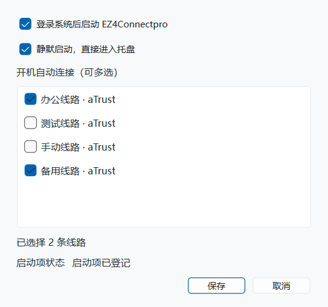

# EZ4Connectpro

EZ4Connectpro 是面向深信服 aTrust 和 EasyConnect 的轻量 VPN 工作台。Windows x64 版集成为一个 **27.1 MiB 的便携 EXE**，比上游发布包小 **82.0%**。常用 VPN 配置可以集中管理，也可以按需同时连接。

[项目主页](https://github.com/HuoXiaolin/EZ4Connectpro) · [发布页](https://github.com/HuoXiaolin/EZ4Connectpro/releases) · [使用说明](docs/VPN_WORKSPACE.md)

## Windows x64 体积对比

| 版本 | 发布文件 | 展开后的运行文件 |
| --- | ---: | ---: |
| EZ4Connect v1.9.1 | ZIP，150.9 MiB | 354.4 MiB |
| EZ4Connectpro 2.0.1 | 单文件 EXE，27.1 MiB | 56.6 MiB |

同为 Windows x64，发布文件减少约 **123.8 MiB**。Pro 版改用外部浏览器完成单点登录，移除了内置的 Qt WebEngine。便携 EXE 仍包含 Qt 运行库、zju-connect 和 Wintun，启动时将运行文件展开到临时目录，正常退出后清理。 [上游 v1.9.1 发布附件](https://github.com/chenx-dust/EZ4Connect/releases/expanded_assets/v1.9.1)

### 与深信服官方 aTrust 对比

深信服 aTrust **2.5.16.50 标准版**的 Windows 安装包约 **201.2 MiB**。与它相比，EZ4Connectpro 的便携 EXE 小 **86.5%**。 [深信服官方下载页](https://atrustcdn.sangfor.com/tools/clientVersion/index.html)

运行时，Pro 的 EXE 与展开的程序文件合计约 **83.8 MiB**。以官方客户端安装后占用 **300 MiB** 或 **1 GiB** 的部署为例，Pro 的程序文件分别少约 **72%** 和 **92%**。官方客户端的实际安装占用随版本和部署组件变化。

## 主要功能

- **多配置工作台**。集中管理 aTrust 和 EasyConnect，按名称、协议或网关查找配置。每条连接各自显示状态和代理端口，活动日志带有配置标记。
- **配置备份和开机连接**。在「文件」导入或导出 INI，在「设置 → 启动设置」统一管理静默启动，可勾选多条线路在登录系统后自动连接。 [工作台使用说明](docs/VPN_WORKSPACE.md)
- **托盘查看和管理连接**。图标右上角黄点表示连接或重连中，绿点表示已连接。鼠标悬停可查看线路和通道状态，右键可独立操作每条线路或断开全部连接。
- **外部浏览器登录**。aTrust 的 CAS 和 HTTPS OAuth2 默认使用临时浏览器配置，自动接回登录票据。也可选择系统默认浏览器，借助回传扩展使用已有浏览器配置。 [浏览器登录说明](docs/VPN_WORKSPACE.md#单点登录的两种浏览器方式)
- **内网分流和本机代理**。Windows 为开启 TUN 的配置分配独立虚拟网卡，按网关路由访问内网。遇到虚拟 IP、下发网段或 DNS 劫持冲突时，会阻止新连接并显示原因。关闭 TUN 后可使用该配置的 HTTP 或 SOCKS5 代理。 [高级使用方式](docs/ADVANCED_USAGE.md)

## 界面截图

### 连接工作台

左侧选择或新建配置，右侧查看连接阶段、代理端口和活动日志。「更多操作」提供重命名、删除及适用的登录维护操作。截图使用示例网关。


### 浏览器登录设置

选中配置，在「编辑配置 → 认证」中选择登录浏览器。该设置按连接配置保存。


### 托盘连接状态

右键菜单同步显示所有线路，展开线路可查看协议、网关和本机代理端口。图中为隔离测试数据，一条线路已连接，另一条正在重连。


### 多线路开机连接

在「设置 → 启动设置」勾选需要开机连接的线路。可以同时选择多条，也可以全部取消、仅启动软件；各线路仍独立检查端口和网络冲突。图中勾选了两条示例线路。



## 快速开始

1. 双击 `EZ4Connectpro-windows-x64.exe`。从源码构建时，默认成品在 `out` 目录。
2. 在工作台点击「新建配置」，选择 aTrust 或 EasyConnect，填写网关和认证信息。已有配置可直接在左侧选中。
3. 点击「连接 VPN」，按网关要求完成认证。首次启动 TUN 时按提示授予 Windows 管理员权限。

配置和日志保存在 EZ4Connectpro 的应用数据目录。系统代理由其他软件管理时，浏览器的内网流量需要直连，才能进入本机 VPN 路由。 [浏览器访问内网页面](docs/VPN_WORKSPACE.md#浏览器访问内网页面)

## 开发

项目的分层、依赖方向和新增代码归属规则见
[架构说明](docs/ARCHITECTURE.md)。

### 构建 Windows x64 便携版

便携包使用 Qt 6.10.3、对应的 C++ 编译器、CMake、Ninja 和 Go 构建。将 Qt 的 `bin`、编译器、Go 和 Git 加入 `PATH`，Qt 需包含 `qt5compat` 和 `qtwebsockets` 模块。便携启动器使用 `windres.exe` 写入图标和版本信息。Windows 打包使用固定的 zju-connect v1.3.1 源码和 [多网卡补丁](scripts/windows-core/zju-connect-v1.3.1-tun.patch)，复用 Go 模块缓存。也可用 `-CoreArchive` 指定已经编译好的核心包。

```powershell
cmake -S . -B build/windows-x64 -G Ninja -DCMAKE_BUILD_TYPE=Release
cmake --build build/windows-x64 --parallel
.\scripts\package-windows-single-file.ps1 -BuildDir build/windows-x64
```

本机已有工具和依赖集中保存在 `D:\Agant\toolchain\EZ4Connectpro`。可运行 `.\scripts\build-windows.ps1 -Test -Package`，复用工具离线构建、在独立 Windows 桌面验证并输出单文件。工具目录可通过 `-ToolsRoot`、`-SdkRoot`、`-GoModules` 指定。该脚本不自动下载缺失依赖。

完成交付后，可用 `.\scripts\clean-workspace.ps1` 预览可重建产物，核对后加 `-Apply` 清理。保留 `out` 最新单文件、源码、测试和脚本，共享工具与离线依赖不在清理范围内。

## 许可证

本项目遵循 [GNU General Public License Version 3](LICENSE) 开源。

## 致谢

- [chenx-dust/EZ4Connect](https://github.com/chenx-dust/EZ4Connect)
- [Mythologyli/ZJU-Connect-for-Windows](https://github.com/Mythologyli/ZJU-Connect-for-Windows)
- [Mythologyli/zju-connect](https://github.com/Mythologyli/zju-connect)
- [lyc8503/EasierConnect](https://github.com/lyc8503/EasierConnect)

> 欢迎加入 HITSZ 开源技术协会 [@hitszosa](https://github.com/hitszosa)
